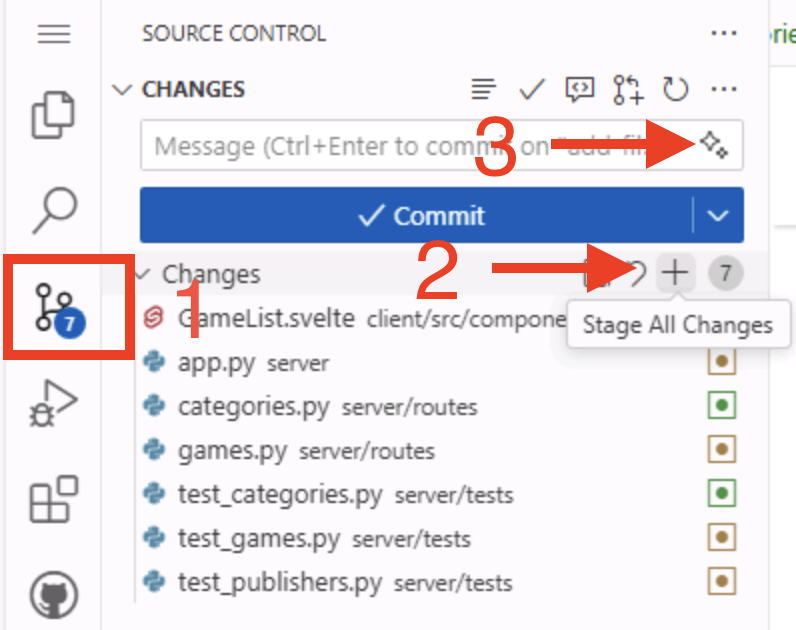

[← Lección anterior: Modo de agente][previous-lesson] · [Siguiente lección: Agentes personalizados →][next-lesson]

Acabas de crear la funcionalidad de filtrado con el modo de agente. Antes de abrir una pull request, confirma que funciona en el navegador. En lugar de probar la aplicación manualmente, conectarás el **servidor Playwright MCP** y dejarás que Copilot use un navegador real para probar la funcionalidad. Después, publicarás la rama y abrirás la PR.

En este ejercicio:

- aprenderás qué es Model Context Protocol (MCP) y cómo los servidores MCP amplían Copilot con nuevas herramientas.
- añadirás el servidor Playwright MCP al espacio de trabajo.
- pedirás a Copilot que lo use para probar manualmente la funcionalidad de filtrado en un navegador.
- publicarás la rama y abrirás una pull request para el trabajo de filtrado.

## ¿Qué es Model Context Protocol (MCP)?

El modo de agente es mucho más potente cuando puede acceder a elementos que van más allá del editor. Model Context Protocol (MCP) permite a Copilot hacerlo: es un estándar que permite al agente comunicarse con herramientas y servicios externos.


[Model Context Protocol (MCP)](https://github.blog/ai-and-ml/llms/what-the-heck-is-mcp-and-why-is-everyone-talking-about-it/) permite que los agentes de IA se comuniquen con herramientas y servicios externos. Así pueden acceder a información actualizada mediante recursos y realizar acciones en tu nombre mediante herramientas.

Los agentes acceden a estas herramientas y recursos a través de un servidor MCP, que actúa como puente entre el agente de IA y los servicios externos. El servidor MCP administra la comunicación entre el agente y las herramientas externas, como las API existentes o herramientas locales como los paquetes de NPM. Cada servidor MCP representa un conjunto distinto de herramientas y recursos a los que el agente puede acceder.

Algunos servidores MCP populares son:

- **[GitHub MCP Server](https://github.com/github/github-mcp-server)**: proporciona acceso a varias API para gestionar repositorios de GitHub. Permite realizar acciones como crear repositorios, actualizar los existentes y gestionar incidencias y pull requests.
- **[Playwright MCP Server](https://github.com/microsoft/playwright-mcp)**: proporciona automatización del navegador mediante Playwright. Permite realizar acciones como navegar por páginas web, rellenar formularios y seleccionar botones.

Hay muchos otros servidores MCP disponibles que proporcionan acceso a distintas herramientas y recursos. GitHub aloja un [registro MCP](https://github.com/mcp) para facilitar el descubrimiento y las contribuciones al ecosistema.

> [!CAUTION]
> En materia de seguridad, trata los servidores MCP como cualquier otra dependencia del proyecto. Antes de usar uno, revisa su código fuente, verifica quién lo publica y considera las implicaciones de seguridad. Usa únicamente servidores MCP de confianza y ten cuidado al conceder acceso a recursos u operaciones sensibles.

## Revisa la configuración de MCP

El archivo `.vscode/mcp.json` configura los servidores MCP disponibles en este espacio de trabajo de VS Code.

1. Abre `.vscode/mcp.json` en tu codespace.
2. Deberías encontrar un servidor `github` ya configurado:

    ```json
    {
      "servers": {
        "github": {
          "type": "http",
          "url": "https://api.githubcopilot.com/mcp/"
        }
      }
    }
    ```

La plantilla del proyecto incluye la entrada `github`, por lo que Copilot pudo leer el backlog de incidencias en el ejercicio anterior. Usa el [servidor MCP remoto de GitHub][remote-github-mcp-server], así que no hay que instalar nada localmente: VS Code se conecta por HTTP y te autenticas con GitHub la primera vez que Copilot usa una de sus herramientas.

## Añade el servidor Playwright MCP

Ahora añadirás un segundo servidor. El [servidor Playwright MCP][playwright-mcp-server] proporciona a Copilot un navegador que puede controlar, justo lo que necesitas para probar la funcionalidad.

1. En `.vscode/mcp.json`, añade una entrada `playwright` junto a `github` para que el archivo quede así:

    ```json
    {
      "servers": {
        "github": {
          "type": "http",
          "url": "https://api.githubcopilot.com/mcp/"
        },
        "playwright": {
          "command": "npx",
          "args": ["@playwright/mcp@latest", "--headless"]
        }
      }
    }
    ```

2. Guarda el archivo.

A diferencia del servidor remoto `github`, `playwright` es un servidor **local**: VS Code lo inicia en tu máquina con `npx @playwright/mcp@latest`. La opción `--headless` indica a Playwright que ejecute el navegador sin mostrar una ventana, algo necesario en un codespace que no tiene escritorio.

> [!NOTE]
> El proyecto Tailspin Toys ya usa Playwright para las pruebas de extremo a extremo, por lo que normalmente el navegador necesario ya está instalado. Si Copilot indica más adelante que falta un navegador, pídele que ejecute `npx playwright install chromium` y vuelve a intentarlo.

## Inicia el servidor y confía en él

VS Code inicia los servidores MCP **cuando se necesitan**. La primera vez que Copilot necesita las herramientas de un servidor, VS Code lo inicia y te pregunta si confías en él.

1. En `.vscode/mcp.json`, aparecerá la acción **Start** encima de la entrada `playwright`. Selecciónala para iniciar el servidor y confirmar que la configuración es correcta.
2. Si VS Code te pregunta si confías en el servidor, revisa la configuración y confirma que confías en él para que se inicie.

El inicio manual es opcional. Si lo omites, VS Code iniciará el servidor y te pedirá que confirmes que confías en él la primera vez que Copilot necesite sus herramientas.

## Prueba la funcionalidad de filtrado

El [servidor Playwright MCP][playwright-mcp-server] proporciona a Copilot un navegador real. En vez de probar la aplicación manualmente, el agente puede abrir una página, navegar por ella, aplicar filtros y leer los resultados para resumírselos. Es una forma rápida de confirmar que la funcionalidad se comporta como esperas sin salir de la conversación.

El servidor Playwright MCP usa el [árbol de accesibilidad][playwright-mcp-server] de la página, no capturas de pantalla. Por eso, el agente trabaja con elementos estructurados y etiquetados (botones, enlaces y elementos de lista), como hacen las tecnologías de asistencia. Así, una comprobación funcional también sirve como primera revisión de accesibilidad.

Con el servidor conectado y la aplicación en ejecución, pide a Copilot que pruebe la funcionalidad:

```text
Using the Playwright MCP server, open a browser to the running app at http://localhost:4321 and verify the new game filtering feature:

1. Go to the games page and note how many games are listed.
2. Apply a category filter and confirm the list updates to only show games in that category.
3. Clear it, then apply a publisher filter and confirm the list updates to that publisher.
4. Combine a category and a publisher filter and confirm the results respect both.

Report what you observe at each step, and call out anything that does not behave as expected.
```

Copilot abrirá un navegador mediante el servidor Playwright MCP, seguirá cada paso y comunicará lo que observa. Compara el resumen con los criterios de aceptación de la incidencia. Si algo no parece correcto, haz preguntas de seguimiento o pide a Copilot que corrija el código antes de abrir una pull request.

> [!NOTE]
> Para esta prueba, la aplicación debe estar en ejecución en `http://localhost:4321`. Si has detenido el servidor de desarrollo, vuelve a iniciarlo antes de enviar el prompt. La primera vez que Copilot use el servidor Playwright MCP podría tener que descargar un navegador; si indica que falta uno, pídele que ejecute `npx playwright install chromium` y vuelve a intentarlo.

[playwright-mcp-server]: https://github.com/microsoft/playwright-mcp

## Publica la rama y crea una pull request

Ya has confirmado que la funcionalidad funciona. Ahora puedes abrir una pull request (PR) para que el equipo la revise. El primer paso es publicar la rama `filtering-vscode`.

1. Abre el panel **Source Control** del codespace y revisa los cambios de Copilot.
2. Prepara los cambios seleccionando el icono **+**.
3. Genera un mensaje de confirmación con el botón **Sparkle**.

   

4. Selecciona **Publish** para enviar la rama al repositorio.

## Crea la pull request

Hay varias formas de crear una pull request, como github.com y la interfaz de línea de comandos (CLI) de GitHub. Como ya estás trabajando con GitHub Copilot, pídele que cree la PR. Puede encontrar la incidencia correspondiente y asociarla a la PR.

1. Abre el panel Copilot Chat y selecciona **New Chat** para iniciar una sesión nueva.
2. Confirma que está seleccionado **Agent** para que Copilot pueda usar las herramientas de GitHub.
3. Pide a Copilot que cree una PR:

   ```plaintext
   Find the issue in the repo related to filtering by category and publisher. Create a new pull request for the current branch, and associate it with the correct issue.
   ```

4. Si hace falta, selecciona **Continue** para permitir que Copilot recopile información y realice las operaciones necesarias. La primera vez que use una herramienta de GitHub, quizá debas autenticarte; sigue las instrucciones para permitirlo.
5. Observa cómo Copilot busca entre las incidencias, encuentra la correcta y crea la PR.
6. Selecciona el enlace de Copilot para revisar la pull request, pero **no la combines todavía**.

## Resumen y próximos pasos

¡Enhorabuena! En este ejercicio:

- aprendiste qué es Model Context Protocol (MCP) y cómo los servidores MCP amplían Copilot con nuevas herramientas.
- añadiste el servidor Playwright MCP al espacio de trabajo.
- lo usaste para probar manualmente la funcionalidad en un navegador antes de publicarla.
- publicaste la rama y abriste una pull request para el trabajo de filtrado.

Has usado un servidor MCP para *probar* una funcionalidad, pero MCP solo es una de las formas de ampliar Copilot. A continuación, [crearás un agente personalizado][next-lesson] para agilizar tareas concretas, como las revisiones de accesibilidad.

## Recursos

- [Qué es MCP y por qué habla todo el mundo de ello][mcp-blog-post]
- [Servidor Playwright MCP de Microsoft][playwright-mcp-server]
- [GitHub MCP Server][github-mcp-server]
- [Registro MCP de GitHub][mcp-registry]
- [Servidores MCP en VS Code][vscode-mcp-config]

[previous-lesson]: ../2-agent-mode/
[next-lesson]: ../4-custom-agents/
[mcp-blog-post]: https://github.blog/ai-and-ml/llms/what-the-heck-is-mcp-and-why-is-everyone-talking-about-it/
[github-mcp-server]: https://github.com/github/github-mcp-server
[mcp-registry]: https://github.com/mcp
[remote-github-mcp-server]: https://github.blog/changelog/2025-06-12-remote-github-mcp-server-is-now-available-in-public-preview/
[vscode-mcp-config]: https://code.visualstudio.com/docs/agents/reference/mcp-configuration
